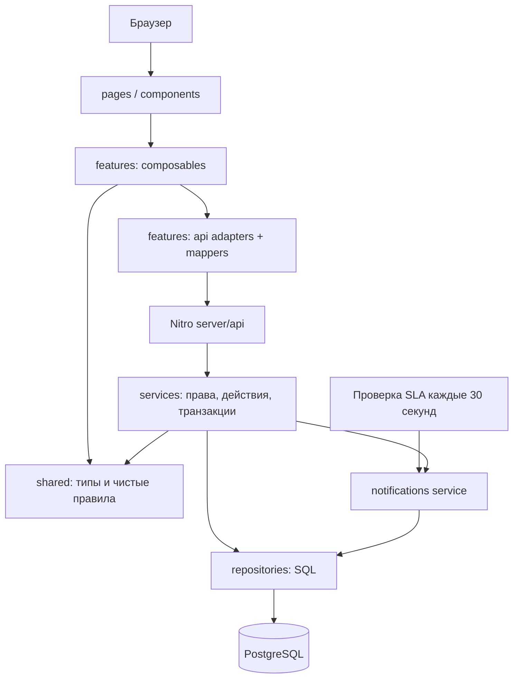
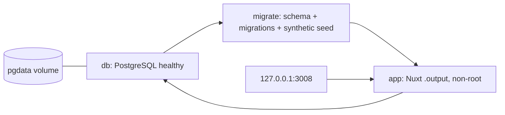

# Архитектура WorkFlow

WorkFlow — модульный монолит: Nuxt отдаёт публичные страницы и кабинет, Nitro обслуживает API, PostgreSQL хранит данные и сессии. Отдельные микросервисы для учебного проекта не нужны.

## Ответственность

| Часть | Что делает |
| --- | --- |
| `app/pages`, components | Показывает данные, принимает ввод, вызывает composables |
| `app/features/*/composables` | Управляет запросами, pending/error, формой, обновлением кеша |
| `app/features/*/api.ts` | Знает HTTP-контракт; mapper превращает API-модель в стабильную UI-модель |
| `server/api` | Читает параметры, валидирует Zod, получает сессию, вызывает сервис |
| `server/services` | Проверяет бизнес-правила и доступ, выполняет действие в транзакции |
| `server/repositories` | Выполняет параметризованный SQL |
| `shared/types`, `shared/utils` | Модели, статусы, SLA, ограничения файлов; не зависят от Vue/Nitro |
| `database` | Базовая схема и последовательные миграции |

Домены: requests, comments, users, customers, categories, auth, notifications, attachments, SLA и analytics. Публичные статьи имеют отдельный read-only API.

`app` не импортирует `server`; repository не импортирует service. UI не выполняет `$fetch` самостоятельно. Бизнес-правила переходов статуса находятся в `shared/utils/request-rules.ts`. Скрытые auto-import зависимости и циклы проверяет `npm run arch:check`.

## Состояние и согласованность

| Вид состояния | Источник |
| --- | --- |
| Поиск, фильтры, сортировка, страница, период аналитики | URL query |
| Заявки, справочники, комментарии, уведомления, SLA | PostgreSQL → useFetch/useAsyncData |
| UI-настройки, optimistic pending, последний Undo | Pinia; настройки сохраняются локально |
| Открытое окно, поля формы, выбранный файл | Local state; черновики вкладки в sessionStorage |

У заявки есть revision: конфликтующее изменение получает 409. Optimistic приоритет откатывается при 409/500. У комментария есть `client_id`; повтор одного запроса не создаёт дубликат. Заявка, история и уведомления сохраняются одной транзакцией. Блокировка заявки защищает количество вложений от одновременных upload. Уникальный ключ уведомления защищает от повторной рассылки SLA.

## Авторизация

Случайный session token находится в HttpOnly/SameSite cookie; в БД хранится SHA-256 token. Пароли хешируются scrypt с отдельной солью. Client получает только собственные заявки, Agent — назначенные ему, Operator и Admin — все. Административные операции доступны только Admin. Проверки выполняет сервер, включая скачивание вложений и прямой запрос по ID.

Logout удаляет серверную сессию, очищает приватный клиентский кеш и выполняет переход на страницу входа. Поздний ответ прежней сессии отбрасывается по версии auth.

## Рендеринг и запуск

Главная и отдельные статьи prerender, FAQ/help/каталог статей — SSR с URL-поиском. Приватные страницы SSR, без prerender/cache и с noindex. Cookie и localStorage применяются так, чтобы первый клиентский HTML совпадал с серверным.

База не публикует порт наружу. Runtime контейнер содержит только `.output`, работает без root и с read-only файловой системой. `/api/health` проверяет доступность подготовленной БД и не раскрывает конфигурацию. Для публичного стенда нужен HTTPS reverse proxy и пересборка с настоящим `NUXT_PUBLIC_SITE_URL`.

## ADR-lite

1. **Домены с совместимыми входами.** Features содержат реализацию; старые composables остаются короткими re-export. Это сохраняет потребителей, но оставляет временные фасады. Удалять их можно после миграции всех импортов.
2. **Чистые общие правила.** Статусы, SLA и ограничения файлов находятся в shared и тестируются без Nuxt. Клиент помогает пользователю, сервер всегда повторяет проверку. Часть валидации повторяется на границе HTTP намеренно.
3. **Сервисы и SQL repositories без Nuxt Layer.** Транзакции и запросы видны явно; изменение API изолировано mapper. Стало больше небольших файлов, зато UI не зависит от SQL. Layer не используется: второй самостоятельной оболочки приложения нет.

Расширенные ADR предыдущего этапа находятся в `docs/adr`. Компромиссы релиза — [TRADEOFFS.md](TRADEOFFS.md).
