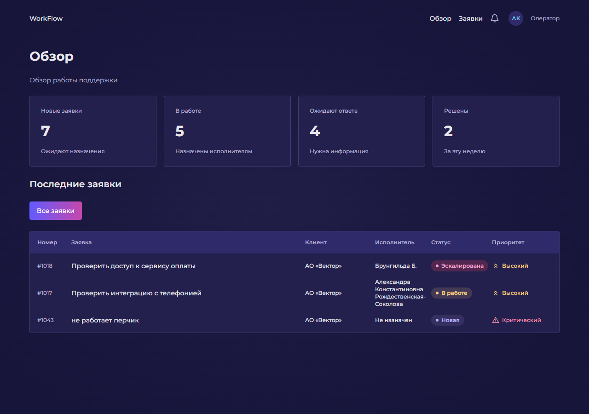
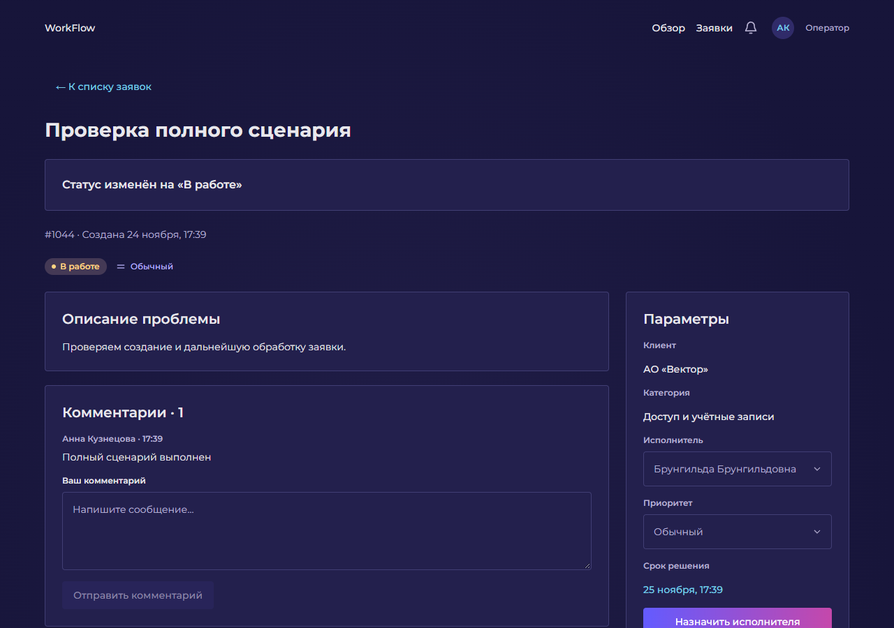
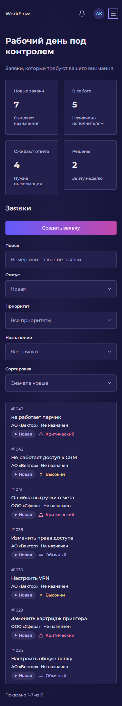

# WorkFlow

Сервис заявок службы поддержки: клиент описывает проблему, оператор назначает исполнителя, специалист фиксирует результат. История, комментарии, файлы и сроки находятся в одной карточке, а сервер проверяет доступ к каждой операции.

Проект выполнен по учебному заданию и [макету Figma](https://www.figma.com/design/ibspqarJdPX1RngLbXpK0u/?node-id=1-35114). Это финальный этап после восьми последовательных версий.

## Возможности

- Четыре роли: Client, Operator, Agent, Admin.
- Поиск с debounce, URL-фильтры, сортировка и pagination.
- Создание и обработка заявок, timeline, комментарии, optimistic приоритет с rollback и Undo.
- Эскалация с причиной, вложения до 10 МиБ, уведомления, настраиваемый SLA и аналитика.
- SSR-публичные страницы, справка и статьи, metadata, sitemap и 404.
- Мобильный интерфейс, keyboard navigation, loading/empty/error и повтор запроса.

## Стек

Nuxt 4.6.4, Vue 3, TypeScript, Pinia, Nitro, PostgreSQL 18.7, Zod. Vitest, Playwright, axe-core, Lighthouse. Node 24.22.3 и Docker Compose. Точные зависимости зафиксированы в `package-lock.json`, образы — digest, действия CI — commit SHA.

## Быстрый запуск с Docker

Нужны Node 24 и Docker с Linux containers / Compose. Команды выполняются из папки проекта:

```sh
node --experimental-strip-types tools/compose-env.ts
docker compose --env-file .env.compose up -d --build --wait
```

Открыть http://localhost:3008. Сначала поднимается PostgreSQL, затем применяются миграции и учебные данные, после этого стартует приложение. Повторный запуск сохраняет данные в volume; существующий пароль `.env.compose` не перезаписывается.

```sh
docker compose --env-file .env.compose ps
docker compose --env-file .env.compose logs app
docker compose --env-file .env.compose down
```

`down` сохраняет БД. `down --volumes` удаляет данные этого Compose-проекта: использовать только для намеренного сброса учебного стенда. Порт PostgreSQL наружу не открыт; HTTP привязан к loopback.

## Запуск без Docker

Нужны Node 24 и PostgreSQL. Создать БД и пользователя с правами на её схему, скопировать `.env.example` в `.env` и заполнить `DATABASE_URL`.

```sh
npm ci
npm run db:init
npm run dev
```

Адрес: http://127.0.0.1:3008. На подготовленном Windows-компьютере можно запустить `start.cmd`: он использует локальный Node SDK и `db:local`.

Production-сборка:

```sh
npm run build
npm start
```

Для хостинга перед сборкой задать настоящий `NUXT_PUBLIC_SITE_URL`, для процесса — `NODE_ENV=production`, `DATABASE_URL`, `HOST=0.0.0.0`, `PORT`. Nitro entry point: `.output/server/index.mjs`. Секрет подключения передаётся окружением, а не коммитом. `.env.example` содержит только образец; `.env` и `.env.compose` игнорируются Git и Docker.

## Demo

Локальный стенд: http://127.0.0.1:3008. Публичный demo URL ещё не подключён. Репозиторий опубликован на GitHub; результат автоматических проверок находится во вкладке Actions. Конфигурация: [.github/workflows/release.yml](.github/workflows/release.yml).

| Роль | Почта | Доступ |
| --- | --- | --- |
| Client | client@workflow.local | Свои заявки |
| Operator | operator@workflow.local | Все заявки и назначение |
| Agent | agent@workflow.local | Назначенные заявки |
| Admin | admin@workflow.local | Все данные, SLA и аналитика |

Пароль всех demo-аккаунтов: **Practice123!**. Это открытые учебные аккаунты, не реальные пользователи. Seed можно выполнять повторно: он не стирает созданные заявки. Фирменная заявка №1043 «не работает перчик» сохранена с описанием «Витя не работает».

[Пятиминутный сценарий](DEMO.md). Видео пользователь записывает самостоятельно и прикрепляет к сдаче.

## Скриншоты







## Архитектура

`pages/components → features/composables → api adapters → Nitro handlers → services → repositories → PostgreSQL`. Общие правила статусов, SLA и файлов находятся в `shared`. Pinia хранит UI, URL — фильтры, PostgreSQL — предметные данные.

Подробности и диаграммы: [ARCHITECTURE.md](ARCHITECTURE.md). Выбранные ограничения: [TRADEOFFS.md](TRADEOFFS.md).

## Проверки

```sh
npm run typecheck
npm run lint
npm run arch:check
npm run release:scan
npm audit --audit-level=moderate
npm test
npm run build
npx playwright install --with-deps chromium
npm run test:release
```

Для последних проверок нужен PostgreSQL и `.env` либо `DATABASE_URL`. Проверяющий пользователь БД должен иметь право создавать временные схемы. Каждый E2E получает чистые fixtures, тестовая схема удаляется в `finally`; рабочая база не очищается.

Тесты проверяют полный путь login → create → assign → status → comment → logout, роли, 401/409/429/500, гонки поиска, повтор комментария, refresh, SLA, эскалацию, файлы и клавиатуру. Axe проверяет выбранные страницы и формы на WCAG A/AA. Это автоматическая проверка, а не сертификат полного соответствия WCAG.

CI выполняет те же проверки на Ubuntu с PostgreSQL service и отдельно собирает чистый Docker Compose, проверяет вход, создание заявки и сохранность после рестарта. Локальные результаты и ограничения среды: [RELEASE_AUDIT.md](RELEASE_AUDIT.md).

## Производительность

```sh
npm run build
npm run perf -- release
```

Lighthouse: три холодных mobile-запуска четырёх страниц, включая авторизованный список. Условия, медианы и бюджет — [PERFORMANCE.md](PERFORMANCE.md). Старые измерения шестого этапа сохранены отдельно и не выдаются за результат текущего релиза.

## Сложные места

Устаревший ответ поиска отменяется; повтор комментария идемпотентен; optimistic изменение учитывает revision и откатывается; logout отбрасывает запоздавшие ответы. Доступ к файлам повторяет права заявки. Переходы статусов проверяет сервер. Миграции запускаются последовательно под блокировкой PostgreSQL, не стирают данные и допускают повторный запуск.

