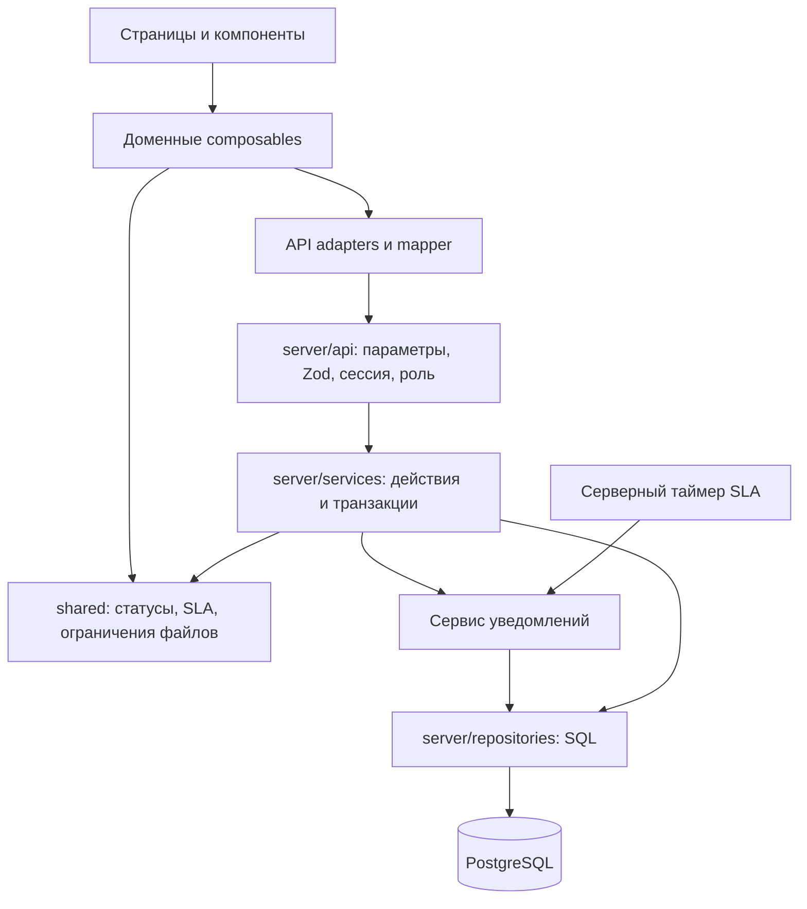

# Архитектура WorkFlow — День 8

Архитектура седьмого дня расширена новыми требованиями. Существующие requests, auth, users, customers и comments сохранены. Notifications теперь обслуживает постоянные сообщения, добавлены attachments, SLA и analytics.



## Домены

| Домен             | Ответственность                                                                         |
| ----------------- | --------------------------------------------------------------------------------------- |
| requests          | Список, детали, действия, optimistic update, Undo, история                              |
| comments          | Черновик, идемпотентная отправка, комментарии                                           |
| auth              | Сессия и роли, защита от запоздавших ответов                                            |
| users / customers | Справочники, профиль, исполнители и клиенты                                             |
| sla               | Административная настройка сроков по приоритетам                                        |
| attachments       | Выбор, проверка, upload и защищённое скачивание                                         |
| notifications     | Сообщения получателям, read state, проверка приближения SLA; отдельно — временный toast |
| analytics         | Административные метрики, период и график статусов                                      |

Категории остаются классификатором заявок. Публичные статьи сохраняют отдельный read-only API и SSR-composables.

## Границы

UI показывает значения и вызывает composables. Composable отвечает за порядок запросов, состояния формы и обновление кеша. `features/*/api.ts` знает HTTP-адрес и типы. Серверный handler проверяет вход и роль; сервис выполняет действие; repository выполняет SQL.

Shared не импортирует Vue, Nitro, server или app. В нём находятся детерминированные правила статусов, SLA, численные ограничения вложений и общие модели ответа. SQL, cookies, потоки upload и таймеры принадлежат серверу.

`app` не импортирует `server`, repository не импортирует service. Совместимые входы `app/composables` сохранены для старых потребителей. Внутри features используются явные зависимости. Нового общего store предметной области нет.

Requests вызывает уведомления внутри своей транзакции. Уведомления не вызывают сервис изменения заявки обратно. Attachments использует чтение/блокировку requests, но requests не зависит от attachments. Это сохраняет направленный граф без циклов.

## Согласованность

- Заявка, история и уведомления изменения сохраняются одной транзакцией.
- Upload блокирует заявку перед проверкой количества и вставкой файлов.
- Файл хранится в БД вместе с метаданными; частично загруженного файла на диске не остаётся.
- Уникальный ключ уведомления не позволяет периодической проверке создавать дубли.
- Сроки — снимок на заявке. Изменение политики не переписывает историю обязательств.
- Роли проверяются API, принадлежность конкретной записи — серверными сервисами/SQL scope.

## Состояние

Поиск, фильтры и период аналитики — URL. Заявки, SLA, файлы и уведомления — PostgreSQL и useAsyncData/useFetch. Pinia — UI-настройки, pending и Undo. Поля формы и выбранный файл — local state. Черновики вкладки — sessionStorage.

## Решения и компромиссы

Три ADR седьмого дня в `docs/adr` остаются основой: домены с совместимыми входами, общие чистые правила, сервисы и репозитории без лишнего Nuxt Layer. На восьмом этапе расширен список доменов, а не создана вторая реализация заявок.

Файлы в PostgreSQL и календарные SLA выбраны для текущего учебного масштаба. Пределы применения и определения метрик подробно описаны в `docs/PRODUCT.md`. Для таймера нужен работающий сервер; в тестах он отключён, события запускаются явно.

## Проверка

```sh
npm run arch:check
npm run arch:report
npm run typecheck
npm run lint
npm test
npm run build
npm run test:e2e
```

`tools/architecture.ts` проверяет импорты, известные Nuxt auto-imports и циклы. Отрицательные тесты подтверждают обнаружение нарушений. Точный текущий граф находится в `docs/architecture/after.json`. Поведение проверяется отдельно реальным PostgreSQL и браузерными сценариями.
